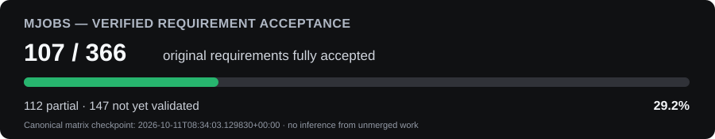

# MJobs

[](docs/PROGRESS_DASHBOARD.md)

> **Development:** One canonical checkout: `C:\Tools\Dev\MJobs`. Codex CLI, Codex in VS Code/Desktop, and explicitly authorized ChatGPT Web GitHub work only. Read [AGENTS.md](AGENTS.md) and [CODEX_START.md](CODEX_START.md). GitHub `main` is the publication branch; obsolete parallel-agent lanes are retired.

> **Progress:** [Requirement index](planning/REQUIREMENT_INDEX.json) (~58 KB), [acceptance dashboard](docs/PROGRESS_DASHBOARD.md), and [concise handoff](planning/SESSION_HANDOFF.md). Full acceptance status is evidence-based, not inferred from commits. Hosted GitHub Actions/reviews are disabled; external job application submission stays OFF.

Local-first job discovery, factual document preparation, and application tracking.
The current user-testing slice includes a connected web application, a public
Greenhouse read-only source, and a controlled fictional application fixture.
Real external submission is disabled.

For the current delivery checkpoint and next ChatGPT session, read the
[session handoff](planning/SESSION_HANDOFF.md) and
[copyable ChatGPT prompt](prompts/CHATGPT_WEB_HANDOFF.md).

With Docker Desktop running Linux containers, start from PowerShell:

```powershell
cd C:\Tools\Dev\MJobs
.\Start-MJobs.ps1
```

The command preserves local data, builds the application, applies migrations,
checks the workers, and opens http://127.0.0.1:18700. See
[the user-testing guide](docs/USER_TESTING.md) for the connected journey,
diagnostics, verification commands, and current limitations.
Run the same command after Docker Desktop restarts to reconcile services without
deleting their named data volumes. The PostgreSQL, Redis, API, and worker
containers use `unless-stopped` restart policies; applying a newer Compose file
to an existing project requires another launcher run.

For a separate personal workspace without fictional discovery or mock application
actions, run `./Start-MJobs.ps1 -Personal` in PowerShell. It uses a separate
Compose project and data volumes at http://127.0.0.1:18701. Public read-only
source collection and factual manual preparation remain available. Real external
auto-submit stays off in both modes.

For an offline PostgreSQL and document backup, followed by a restore into a
separate empty Compose project, use the
[local backup runbook](docs/runbooks/LOCAL_BACKUP.md). Keep backup archives
outside this repository and protect them as personal data.

## GitHub Codespaces

MJobs includes a Codespaces/dev-container environment that mirrors the project
runtime with Python 3.12, Node 24, Docker Compose, Playwright and Codex tooling.
Use it when you want builds, tests, containers and AI development to run on the
Codespace VM rather than the local workstation. See
[docs/CODESPACES.md](docs/CODESPACES.md) for the one-command creation flow,
cloud startup commands, port forwarding, verification and shutdown.
Codex CLI is installed automatically in a new Codespace; sign in explicitly and
use [the bounded iteration entrypoint](prompts/CODESPACES_ITERATION.md). Setup
does not launch agents, start MJobs or install global AFK/PMM skills.

Repository operating instructions live in [AGENTS.md](AGENTS.md). The complete
requirements remain in the GitHub backlog and scoped [area specifications](docs/spec/areas).
This milestone does not represent completion of the full specification.

## Project progress

See the [colored progress dashboard](docs/PROGRESS_DASHBOARD.md) for the current evidence-backed original-requirement, reference-gap, PR-queue, active-work, and known-issue status. The dashboard deliberately separates merged GitHub state from local/uncommitted Codex work.

## Reference-project gap tracking

MJobs also maintains an additive reference-project audit covering JobSpy, CareerWeaver, Resume Matcher, AutoApply, Personal JobPilot, ResuMorph, and AIHawk. See [docs/reference/REFERENCE_PROJECT_GAP_ANALYSIS.md](docs/reference/REFERENCE_PROJECT_GAP_ANALYSIS.md) and [docs/FEATURE_COMPLETENESS.md](docs/FEATURE_COMPLETENESS.md). The canonical additive backlog is `MJ-REF-001..059`; original `MJ-REQ` completion and reference-gap completion are reported separately.

## Live feedback development

Double-click **Start-Feedback.cmd** for the local **Development & Feedback** page:
20 guided tasks, automatic draft saving, restored sessions, and a saved-report
history. No manual template editing is needed, and it works without Docker.
The equivalent VS Code task is **MJobs: Development & Feedback**. Reports remain
private and local; **Ready for Codex** prepares the files for the next instruction
to process your feedback.

For a product-level walkthrough, use [docs/GUIDED_PRODUCT_REVIEW.md](docs/GUIDED_PRODUCT_REVIEW.md) and the VS Code tasks **MJobs: Guided Product Review - Personal/Fixture**.

For browser-driven test/feedback development in VS Code, see [docs/LIVE_FEEDBACK_DEVELOPMENT.md](docs/LIVE_FEEDBACK_DEVELOPMENT.md). Checked-in VS Code tasks can start PERSONAL or FIXTURE mode and a privacy-conscious headed-browser recorder. Session data stays under ignored `outputs/live-feedback/`; use `prompts/VS_CODE_LIVE_FEEDBACK.md` with Codex to turn the latest observation into a test, patch, validation, and retest cycle.


## VS Code — all local MJobs development workspaces

Run the portable Open-MJobs-VSCode.cmd launcher or the PowerShell script
Open-MJobs-VSCode.ps1 in the Mission Control code checkout. It discovers
registered local MJobs Git worktrees and separate private MJobs clones,
builds a manageable generated multi-root VS Code workspace, and opens it.
Local commits appear in Source Control Graph before they are pushed to
GitHub. All registered worktrees are indexed even if not individually opened
in VS Code. The generated machine-specific workspace lives OUTSIDE main.
See [VS Code multi-repository development](docs/VSCode_MULTIROOT_DEVELOPMENT.md)
for commands, dynamic refresh, full-worktree mode and safety guidance.

## Dual-agent feature implementation (Codex + Antigravity)

For isolated local Codex application automation and Antigravity AI matching, follow [the ownership and integration contract](docs/DUAL_AGENT_COORDINATION.md) and [the seven model-specific launch profiles](prompts/dual-agent/README.md). Only the integration owner merges accepted evidence into `main`. Project-hosted Actions/agent runs remain disabled and real external applications are not submitted.


### Launch coding agents visually

Double-click **MJobs Mission Control** on Windows or run
`Start-MJobs-MissionControl.ps1`. Pick a Codex / Antigravity / Claude profile,
model, agent and prompt in the [Mission Control launcher](docs/MISSION_CONTROL_LAUNCHER.md).
The model selector discovers valid CLI model IDs and supported reasoning levels; you never type launch model flags.
Mission Control also offers a visible Windows console (the default) or headless output,
with a viewer for the current/previous CLI log. For Codex, choose separate hard
maximum and intended active subagent counts (0–50). The exact reviewed prompt now
reaches Codex via stdin to avoid Windows CLI truncation; all settings invalidate
previous launch approval when changed. See the
[Mission Control launcher guide](docs/MISSION_CONTROL_LAUNCHER.md#visible-terminals-and-codex-subagent-staffing-october-10).
The Codex launcher now verifies and reuses the pinned MJobs Python virtual environment
for isolated worktrees (avoiding missing Playwright/SQLAlchemy errors), distinguishes
PARTIAL feature acceptance from actual blocked CLI runs, and offers a readable
recent-run summary in the separate output viewer while retaining full raw logs.
These supervised launches remain noninteractive Codex exec sessions; see the
[launcher troubleshooting guide](docs/MISSION_CONTROL_LAUNCHER.md#october-10-correct-false-environment-blockers-and-fragmented-cli-output).

The integrated Development history panel polls local Git every five seconds, distinguishing core
features, tests, docs, and bookkeeping by changed files, with expandable file details and separate
Codex turn activity. Details: [Mission Control history](docs/MISSION_CONTROL_LAUNCHER.md#live-development-history-timeline-october-10).
Choose a preset agent/session name or create your own label.
For a sustained ChatGPT Web coding session, use the [maximum-impact development prompt](prompts/CHATGPT_WEB_PRO_MJOBS_MAXIMUM_SPRINT.md).
It can start independent worktrees while root `main` is dirty and it displays
the same canonical requirement acceptance as the [mjobs-progress skill](skills/mjobs-progress/SKILL.md).
