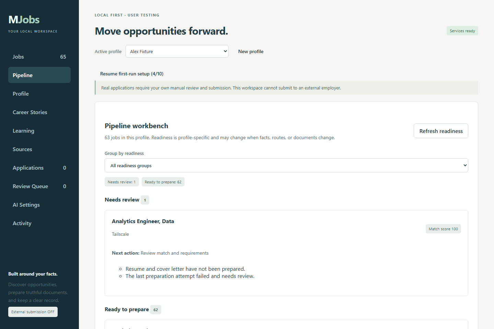
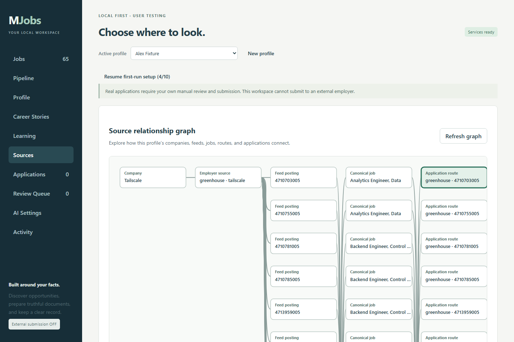
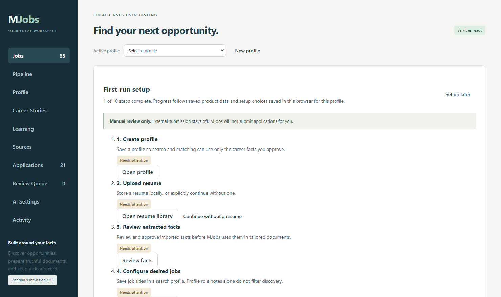
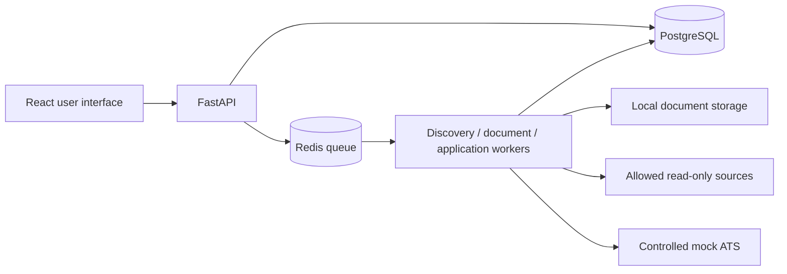

<div align="center">

# MJobs
### Your career facts. Your job search. Your workspace.

A self-hosted workspace for discovering opportunities, reviewing your career evidence,
and preparing applications without losing control of your data.

[](https://github.com/MulattoTech/MJobs/actions/workflows/ci.yml)
[](https://github.com/MulattoTech/MJobs/actions/workflows/integration.yml)
[](LICENSE)

[Install](docs/INSTALLATION.md) · [Try the demo](docs/USER_TESTING.md) · [Architecture](docs/ARCHITECTURE.md) · [Develop](docs/DEVELOPMENT.md) · [Roadmap](https://github.com/users/MulattoTech/projects/1)

</div>



> [!IMPORTANT]
> **Public developer preview, not a production-ready release.** Working components and passing builds are not proof that the full product is accepted. External employer submissions stay **OFF**. Review the [acceptance dashboard](docs/PROGRESS_DASHBOARD.md) and [security policy](SECURITY.md) before using personal data.

## What you can explore

| Workflow | Current building blocks |
|---|---|
| Build a career profile | Import original documents, explicitly review facts, keep versions and approved answers. |
| Find opportunities | Supported read-only sources, employer/source records, normalized jobs and source provenance. |
| Decide what matters | Saved searches, explainable matching components, shortlist and pipeline views. |
| Prepare carefully | Factual resume/cover-letter components, document history, ATS route and form review. |
| Recover your work | Durable operations, bounded retries, service readiness, isolated modes and backup/restore tools. |

These are implemented components, **not a promise of complete end-to-end acceptance**. Automatic employer enrollment, advanced matching, durable document comparison, several ATS workflows and browser regressions still have open requirements.

## Start on Windows

Install Git and Docker Desktop. Start Docker Desktop in **Linux-container mode**, then open PowerShell:

```powershell
git clone https://github.com/MulattoTech/MJobs.git
cd MJobs
.\Start-MJobs.ps1
```

Open **http://127.0.0.1:18700**. The launcher builds the application, initializes a fresh fictional workspace, runs migrations and waits for service readiness. The first build takes longer than later starts.

Load the fictional demo, inspect Jobs and Sources, review a profile, prepare sample documents and exercise the local mock application. Nothing is sent to a real employer.

### Keep personal data separate

```powershell
.\Start-MJobs.ps1 -Personal
```

Use **http://127.0.0.1:18701**. PERSONAL and FIXTURE modes have separate Compose projects and persistent volumes. Do not use real resumes in the fictional test workspace.

**Upgrading an existing installation?** Preserve its `.env`, original credential-encryption key and database/document volumes. Do not regenerate keys or delete volumes to repair startup. Read the [installation and upgrade guide](docs/INSTALLATION.md) and [backup/restore runbook](docs/runbooks/LOCAL_BACKUP.md) first.

## A look inside

<details>
<summary><strong>Employer sources and provenance</strong></summary>



</details>

<details>
<summary><strong>First-run setup</strong></summary>



</details>

Screenshots were captured on October 11, 2026 using a synthetic profile. Some listings are publicly sourced. They show real application screens, not rendered product mockups.

## How the pieces fit



The [architecture guide](docs/ARCHITECTURE.md) distinguishes implemented boundaries from outstanding product goals.

## Development and project health

Start with [DEVELOPMENT.md](docs/DEVELOPMENT.md), [CONTRIBUTING.md](CONTRIBUTING.md) and the short [agent contract](AGENTS.md). Use one integration owner, short-lived pull requests and independent hosted checks. The [automation guide](docs/maintainers/AUTOMATION.md) explains required checks, test artifacts, Projects synchronization and release gates.

| Need | Go here |
|---|---|
| User walkthrough and known limits | [Local user testing](docs/USER_TESTING.md) |
| Product acceptance | [Evidence-backed dashboard](docs/PROGRESS_DASHBOARD.md) |
| Priority work and security backlog | [GitHub Project](https://github.com/users/MulattoTech/projects/1) |
| Current implementation handoff | [Session handoff](planning/SESSION_HANDOFF.md) |
| Versioning and distribution | [Release guide](docs/maintainers/RELEASES.md) |
| Private security reporting | [Security policy](SECURITY.md) |

## License and responsible use

Original MJobs work is licensed under [Apache-2.0](LICENSE). Dependencies and third-party materials retain their own terms; see [NOTICE](NOTICE) and [THIRD_PARTY_NOTICES.md](THIRD_PARTY_NOTICES.md).

Never commit resumes, application answers, cookies, credentials, private `.env` files or database backups. Third-party job content is untrusted input. Respect source policies and access controls; never use real external submissions as automated tests.
