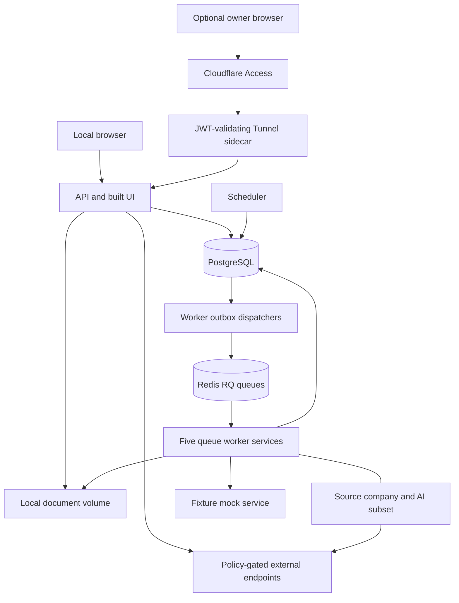
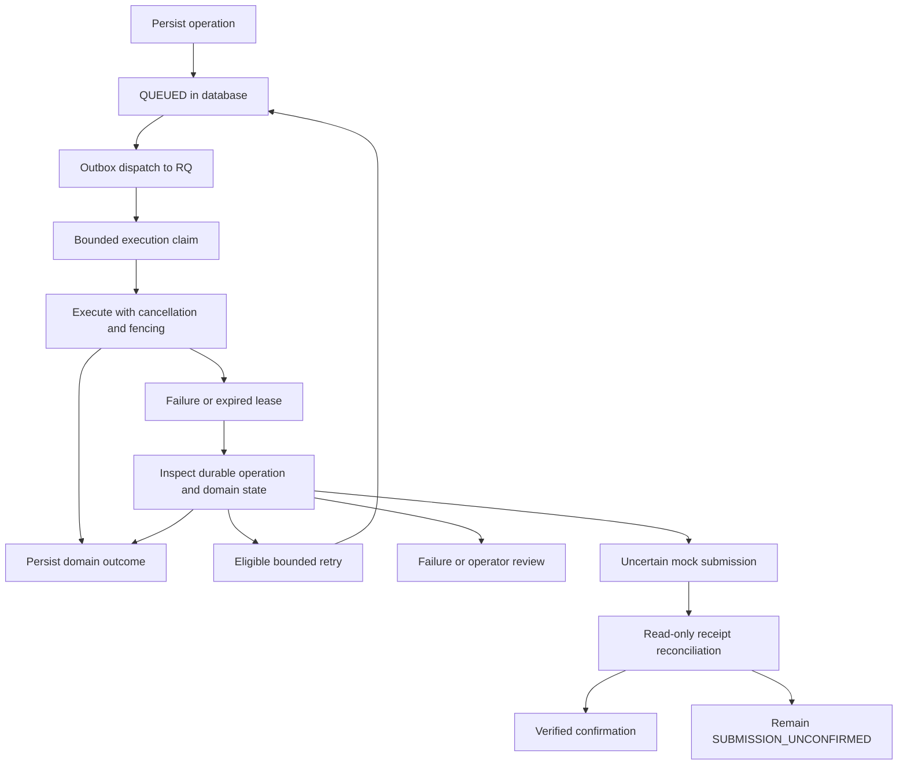

# MJobs architecture and trust boundaries

MJobs is a self-hosted, review-first job discovery and application-preparation system.
This document maps the implemented boundaries required by MJ-REQ-285; it is not a
claim that every provider or user flow has passed acceptance. The deployment source
of truth for the default stack is [compose.yml](../compose.yml), with the optional
protected-preview topology described in the [deployment runbook](../infra/deploy/README.md),
not the illustrative layout in
[REPO_MAP.md](REPO_MAP.md). Provider behavior belongs behind adapters; the browser UI
is not the authority for durable workflow state.

## Services

[FastAPI](../apps/api/main.py) exposes the API and serves the built React/TypeScript
UI from `apps/web/dist`. There is no separate web service in default Compose.
The [multi-stage image](../infra/docker/Dockerfile) builds the UI and packages
Python, document tools and Playwright Chromium under a non-root user.

| Compose service | Responsibility / entry point | Networks |
| --- | --- | --- |
| `postgres` | PostgreSQL 17, authoritative durable records | `private` |
| `redis` | Redis 7 with append-only persistence, RQ delivery | `private` |
| `migrate` | `cli.provision_database`: guarded migration and runtime login | `private` |
| `api` | `apps.api.main:create_from_env`: API and built UI | `private`, `ui`, `source-egress` |
| `scheduler` | `services.discovery.scheduler`: due-work admission and configured retention | `private` |
| `worker` | `workers.main`: application queue | `private` |
| `source-worker` | `workers.main`: discovery queue | `private`, `source-egress` |
| `company-discovery-worker` | `workers.company_discovery_worker`: company queue | `private`, `source-egress` |
| `ai-worker` | `workers.main`: AI queue and configured providers | `private`, `source-egress` |
| `document-worker` | `workers.main`: document queue | `private` |
| `mock` | `fixtures.mock_server`: fixture-profile-only provider | `private` |

`private` is an internal network. Only the API publishes a host port, bound to
`127.0.0.1` (default 18700). `source-egress` permits access; it is not itself a
provider allowlist. URL/provider policies are enforced in code. The API also has
egress: do not model all external access as worker-only.

The optional owner-only PERSONAL preview adds an ingress boundary outside this
Compose service list: remote browser, Cloudflare Access, then a separately managed
Tunnel sidecar that validates the Access JWT and forwards to `api:8000` on the `ui`
network. The API's host/origin guards are not a replacement for that edge identity
check. The [deployment runbook](../infra/deploy/README.md) identifies an isolated
`mjobs-micro` clone/project on Windows Docker Desktop's shared WSL2 engine, with
loopback port 18801 and a [network override](../infra/deploy/windows/compose.micro.yml).
It identifies the old Ubuntu deployment as preserved recovery material, not the
active origin. These are documented deployment arrangements, not live host facts
independently verified by this architecture document.

Compose accepts `MJOBS_IMAGE` for a SHA-tagged runtime image; the API also receives
`MJOBS_PUBLIC_HOST` and `MJOBS_DEPLOY_SHA`. [API startup](../apps/api/main.py) validates
the configured hostname and revision, while `/__deployment` exposes only the source
SHA, version and workspace mode. A candidate image or reported revision is not
proof of authenticated remote workflow acceptance.

The diagram groups workers; the table specifies egress. Runtime services wait for
successful migration; worker/API startup also waits for Redis health. Health checks
are observations, not proof of completed user workflows.

## Database

[SQLAlchemy models](../packages/persistence/models.py) and the
[Store](../packages/persistence/store.py) own persistent state, with
[Alembic migrations](../migrations/) owning schema evolution. PostgreSQL is the
Compose backend; SQLite test paths do not prove PostgreSQL locking or migration
behavior. Profiles, sourced facts, postings, canonical jobs, routes, matches,
documents, applications, operations and audit records have different responsibilities:
a source posting is not an application receipt.

[Provisioning](../cli/provision_database.py) uses administrator access for guarded
migration, then grants a restricted runtime login. The
[runtime entry point](../cli/runtime_database.py) reads that credential from the
read-only `runtime-database` mount rather than falling back to an administrator.
The `database` volume stores PostgreSQL data; `documents` stores artifacts;
`queue` stores Redis data; fixture receipts use `mock-receipts`.
`migration-backups` is separate from the host's verified full recovery archive.
Detailed ER/schema documentation is in [DATABASE.md](DATABASE.md), owned by the
separate requirement MJ-REQ-286.

## Workers

[workers/main.py](../workers/main.py) selects one RQ queue and starts a periodic
outbox dispatcher. [workers/tasks.py](../workers/tasks.py) executes the operation
kind; the [company entry point](../workers/company_discovery_worker.py) specializes
queue selection. Each process validates operation mode, queue and limits.

[Operation control](../workers/operations.py) supplies durable claims, category
concurrency limits, leases, cancellation and attempt fencing. Categories are source
collection, company discovery, AI, document generation and application automation.
Queued and inline operations share controls: AI evaluation, resume extraction,
uploaded-resume comparison and manual authentication also have inline kinds. Thus
not every expensive operation goes through Redis, and losing a browser request
is not a universal cancellation signal.

## Queues

The routing contract is `QUEUES` in [workers/operations.py](../workers/operations.py):

| Queue | Operation kinds |
| --- | --- |
| `mjobs-discovery` | `DISCOVER` |
| `mjobs-company-discovery` | `COMPANY_DISCOVER`, `COMPANY_SOURCE_REFRESH` |
| `mjobs-ai` | `AI_EVALUATE_QUEUED` |
| `mjobs-document` | `PREPARE`, `RESUME_EXTRACT_QUEUED`, `UPLOADED_RESUME_COMPARE_QUEUED` |
| `mjobs-application` | `APPLY_MOCK`, `APPLICATION_FORM_REVIEW`, `APPLICATION_DRY_RUN` |

[Dispatch](../workers/dispatch.py) first persists an operation in the database.
Dispatchers scan due queued records, serialize PostgreSQL dispatch with an advisory
transaction lock, and use the operation ID as the RQ job ID. Redis unavailability
does not erase queued database work. This is not an exactly-once distributed
transaction: execution claims and domain reconciliation protect replay, and RQ
job completion alone does not establish application success.

## Source pipeline

[Configured collectors](../services/discovery/sources/collect.py) select a source
adapter, fetch bounded batches, normalize records and persist posting provenance.
[Search semantics](../services/discovery/search_semantics.py) handles normalized
fields; [lifecycle handling](../services/discovery/lifecycle.py) preserves revisions
and observations rather than treating a missing posting as proof of closure.
Canonical identity and route authority are resolved separately from discovery.

The [scheduler](../services/discovery/scheduler.py) admits due sources and saved
searches into durable operations; collection runs on workers. Enabled state,
cadence, backoff and active-operation checks constrain scheduling. The
[fixture pipeline](../services/discovery/pipeline.py) uses an explicit local mock
origin and must not be mistaken for the public provider transport. See
[the discovery area contract](../services/discovery/AREA.md) for the adapter contract.

## Company discovery

[Requests](../services/company_discovery/requests.py) and
[triggers](../services/company_discovery/triggers.py) admit work; the
[flywheel](../services/company_discovery/flywheel.py) connects company resolution,
career-source discovery and enumeration. Public discovery uses the bounded
[public client](../services/company_discovery/public_client.py) and
[resolution policy](../services/company_discovery/public_resolution.py).
Candidate domains and names are evidence, not automatically verified employer identity.

[ATS enrollment](../services/company_discovery/ats_enrollment.py) binds supported
verified sources to employer authority; ambiguous or unsupported discoveries retain
review boundaries. [Monitoring](../services/company_discovery/monitoring.py) owns
recurring company-source work. Source disablement and authority revocation must not
be bypassed by rediscovery. Provider breadth is not implied by this pipeline; see
[the company discovery area contract](../services/company_discovery/AREA.md).

## Dedupe

[Ingestion identity](../services/dedupe/ingestion_identity.py) establishes canonical
job identity while [source values](../services/dedupe/source_values.py) preserves
source-attributed candidates and resolves authoritative values. Similarity
[policy](../services/dedupe/policy.py) and [review decisions](../services/dedupe/reviews.py)
are distinct from strong identity. Similar titles or shared boilerplate alone must
not turn unrelated vacancies into one job.

[Routes](../services/dedupe/routes.py) and
[route trust](../services/dedupe/route_trust.py) separate application destinations
from discovery URLs. A duplicate posting does not authorize a new submission, and
an aggregator link does not establish an official employer route.

## Matching

The [matching engine](../services/matching/engine.py) composes transparent scoring
signals and explicit unknowns. [Profile scoring](../services/matching/profile_scoring.py)
and [selected-search scoring](../services/matching/selected_search_scoring.py) bind
evaluation to relevant inputs; [discovery explanations](../services/discovery/matching.py)
connect results to ingestion. Scores explain suitability, not invented qualifications
or authorization to apply. Changed profile/search inputs require fresh scoped
evaluation rather than presenting an old score as current.

## Documents

[Generation](../services/documents/generate.py) prepares factual, versioned documents
from approved inputs and route choices, using [validation](../services/documents/validation.py)
before output publication. [Artifact helpers](../services/documents/artifacts.py)
write through temporary paths and atomic publication; database metadata and local
files remain separate recovery concerns. The document worker handles queued
preparation, extraction and comparison, not employer submission.

[Uploads](../services/documents/uploads.py),
[resume workspace revisions](../services/documents/resume_workspace.py) and
[archive storage](../services/documents/archive_store.py) retain different original,
reviewed and generated artifacts. Do not overwrite an original to make a generated
revision appear approved. `MJOBS_OUTPUT_DIR` points to the local document volume in
Compose; backup/recovery must account for files as well as database records.

## Application automation

The [provider registry](../services/applications/provider_registry.py) dispatches
provider-specific route normalization and declared capabilities. Registry membership
is not proof of live-provider submission support. [Form review](../services/applications/form_review.py)
and [controlled dry runs](../services/applications/controlled_dry_run.py) are separate
from [mock execution](../services/applications/mock_adapter.py).
[Run requests](../services/applications/run_requests.py) enforce durable admission
and retry boundaries; document readiness and route review precede execution.

**Real external application submission remains OFF.** Review, manual authentication,
dry-run evidence and mock confirmation never imply employer acceptance. An uncertain
submission is not safe to replay merely because a worker stopped. The
[confirmation recovery service](../services/applications/confirmation_recovery.py)
performs read-only MOCK receipt reconciliation: a missing or unverifiable receipt
leaves an uncertain submission `SUBMISSION_UNCONFIRMED`, not a fabricated success
or proof of non-submission. See [the application area contract](../services/applications/AREA.md).

## Recovery

Recovery has separate queue, domain and storage layers:

[Operation recovery](../workers/operations.py) handles expired claims, cancellation,
dead letters and already-persisted outcomes. [Transient-failure retry policy](../workers/retries.py)
is deliberately limited to eligible read-only discovery failures with bounded
attempts/backoff; it is not a generic retry policy for documents, AI or applications.
Expired-lease recovery can requeue other eligible operation kinds after checking
durable outcomes; uncertain AI calls block and uncertain mock submissions reconcile
rather than blindly repeat the external action. Manual browser capacity is not
released simply because a lease expired: closure
evidence belongs to [manual-auth recovery](../services/applications/manual_auth_recovery.py).

[Runtime health](../services/runtime_health.py) and API readiness expose dependency
and worker observations. [Local backup](../cli/local_backup.py),
[guarded migration](../cli/guarded_migration.py) and
[fixture Compose recovery checks](../cli/compose_recovery.py) address different
failure scopes. A restart does not replace a verified archive restore; encryption
keys and original protected configuration must be preserved, not rotated as a
recovery shortcut.

Protected-preview updates are a separate host-managed control plane, not an RQ
worker. The [main candidate workflow](../.github/workflows/mjobs-deployment-candidate.yml)
waits for [independent exact-SHA main checks](../tools/deploy/wait_for_checks.py),
builds the image and records `CANDIDATE_VALIDATED_NOT_DEPLOYED`. A green PR or that
manifest alone does not mean deployment occurred.

The [Windows updater](../infra/deploy/windows/update_mjobs_micro.py) requires the
deployment candidate, CI, PostgreSQL/Redis integration and secret-scan gates for
the main SHA. It uses isolated release directories and SHA-tagged images, rejects
changed Alembic sources, rechecks main/checks before rollout, quiesces this project's
writers, and verifies a database/document backup before reusing persistent volumes.
Readiness and `/__deployment` must match the expected SHA and PERSONAL mode. Failure
after stopping writers attempts the prior image; rollback failure is reported, not
silently treated as recovery. Changed migrations require separate guarded operator
control; image rollback is not an automatic database downgrade.

The [runbook](../infra/deploy/README.md) documents a periodic Windows Scheduled Task
and user-sign-in-dependent Docker startup, not an always-available independent
server. Host uptime, protected configuration, keys and backup retention remain
operational dependencies. Its authenticated remote session, personal-document
journey and full post-merge update/rollback drill are explicitly unverified there;
do not infer those results from this description or a health response. The retained
[Ubuntu updater](../infra/deploy/host_update.py) is not evidence that two PERSONAL
origins should run concurrently.

## Security

- **Workspace identity:** [operation mode](../packages/domain/operation_mode.py) and
  `Store.bind_workspace_mode` reject incompatible stored identities. PERSONAL and
  FIXTURE deployments must use distinct databases/Compose projects and volumes;
  changing the mode variable alone does not create isolated storage.
- **API and edge identity:** [trusted-host and origin middleware](../apps/api/main.py)
  retains strict localhost defaults and optionally permits one explicit
  `MJOBS_PUBLIC_HOST`, whose expected origin is HTTPS even when the tunnel reaches
  the API over HTTP. Cross-origin protections are not native user authentication:
  the remote preview depends on separately configured Cloudflare Access and
  ingress JWT validation. MJobs still has no native multiuser authentication;
  loopback binding and an allowed host alone do not make public exposure safe.
- **Untrusted sources:** the [public client](../services/company_discovery/public_client.py)
  and [source transport](../services/discovery/sources/http_transport.py) implement
  bounded fetch behavior. Public discovery validates destinations, DNS/IP and
  redirects; fixture origins have separate local-only rules. CAPTCHA, MFA, access
  controls and rate limits are not bypass targets.
- **Credentials and egress:** the [credential vault](../services/credentials/vault.py)
  encrypts stored provider credentials with authenticated encryption. Local storage
  does not mean zero egress: configured AI/provider calls can transmit authorized
  request data and credentials. API/AI key access and network placement are explicit
  in Compose; never include values in logs or evidence.
- **Verification:** checked-in [automation](maintainers/AUTOMATION.md) describes
  synthetic disposable CI, not current CI availability or a successful run. Do not
  put personal applicant data into test fixtures or public artifacts.

Architecture coverage is separate from acceptance. The
[capability matrix](../planning/CAPABILITY_MATRIX.json) and
[reference-gap matrix](../planning/REFERENCE_GAP_MATRIX.json) are separate authorities;
the [requirement index](../planning/REQUIREMENT_INDEX.json) is derived. Code presence,
a diagram, service health, or a passing unit test does not certify a complete flow.
Retain exact-revision evidence and distinguish local, synthetic and real-provider
validation; preserve historical evidence without presenting it as current proof.
